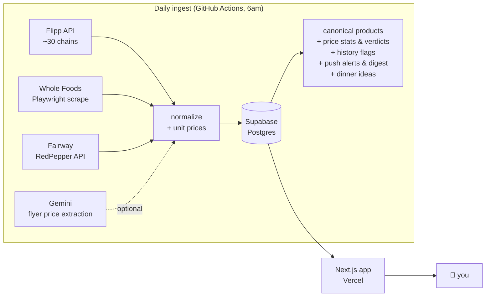

# 📡 Deal Radar

**Every supermarket deal around you, in one feed — scanned automatically every morning.**

Enter your address once. Deal Radar finds every grocery store within your radius, reads all of
their weekly flyers (including the painful PDF flip-book ones), and gives you one clean,
searchable feed of real deals with photos, prices, and discounts — plus a shopping list that
tells you which store is cheapest this week.

Built as a personal tool, running entirely on free tiers: **$0/month**.


## Features

- 🛒 **One feed for every store** — ~30 grocery chains via Flipp, plus dedicated adapters for
  Whole Foods (with Prime pricing) and Fairway (whose flip-book circular becomes clean cards
  with the printed flyer price as the image)
- 🔍 **Search + smart sorting** — biggest discount, lowest price, or ending soon; emoji
  category filters; store chips with logos and real walking distances (OpenStreetMap)
- ⚖️ **Unit prices** — $/oz, $/lb computed from package sizes so deals are actually comparable
- 🏷️ **Historical-low badges** — price history accumulates weekly; genuine lows get flagged,
  recurring fake "sales" don't
- 🔢 **Multi-buy done right** — "4/$1" means $0.25 each, not $1 (Flipp's feed drops the
  prefix; we re-fetch item details for nearby stores to get the truth)
- 🧾 **Shopping list that knows quantities** — type "2 lb chicken breast" and stores are
  compared on what that amount actually costs (per-lb pricing, whole packages); pin the exact
  deal you want or hide wrong matches; see what you save vs regular price
- 🗺️ **Trip planner** — one-store, two-store and cheapest-per-item plans with walking time
  and a map; the ★ pick weighs price against your time
- 🛒 **In-store mode** — the list grouped by store with big checkboxes; "Finish trip" logs
  what you bought
- 💰 **Savings tracker** — monthly spend and savings, by category and store, plus habits
  like "milk 3× at C Town, never on sale"
- 🔄 **Synced everywhere** — every browser gets a 6-char code; open the link on another
  device (or share it with the household) and list, watches and purchases follow
- 👀 **Watches + push notifications** — watch "chicken breast", optionally "under $2.50/lb",
  and your phone buzzes the morning it hits that price; tapping opens that exact deal
  (Web Push, works as an installed PWA on iOS)
- 🍳 **Meal planner** — plan 3–7 dinners around this week's deals with your preferences
  ("high protein, no pork"), swap any one, and add every ingredient to the list with the
  right deal already pinned (optional, Gemini free tier)
- ✨ **For you** — a row of deals on things you list, watch and keep buying, plus genuinely
  great prices in your usual categories; "Not interested" hides a product everywhere
- 💎 **Price check** — every product gets a typical sale price across all nearby stores, so
  deals are labelled great (stock up), normal or weak (wait), with how often it goes on sale
- 🧠 **Smart matching** — "hamburger meat" finds Ground Chuck and chicken-breast dog treats
  don't count as chicken breast: deals map to canonical products (a curated dictionary,
  plus Gemini for the long tail, cached so each name is classified once)
- 🗞️ **Weekly digest** — one push when the new flyers land: deals for you, what your list
  costs and where, and the best price of the week
- 📍 **Saved places** — home, work, family: switch with one tap; every saved place is
  included in the morning scan
- 📈 **Price history sparklines**, deal detail sheets with links to the source flyer,
  expandable images (Fairway zooms to the full flyer page in context)
- 📲 **Installable PWA that works offline** — the app and the last deals you loaded open in-store
  with no signal; mobile-first, dark UI

| Landing | Deal detail | List comparison |
|---|---|---|
|  |  |  |

## How it works



- **No paid scraping services.** The sources are the same JSON feeds the stores' own flyer
  widgets use, discovered by watching network traffic. Adapters are pluggable
  (`lib/sources/*` implement one small `DealSource` interface).
- **Data survives flakiness**: per-source *and* per-flyer error isolation, Overpass mirror
  fallback, extraction-price preservation across rate limits, deduped and batched idempotent
  upserts, and a keepalive so GitHub doesn't disable the daily schedule after 60 quiet days.
  The app warns when data is more than 36h old.
- **History is free**: deals upsert daily with validity windows, so price history, "lowest in
  N weeks" badges, and sparklines simply emerge over time.

## Quick start

Prereqs: Node 22+, a free [Supabase](https://supabase.com) project.

```bash
git clone https://github.com/ozansozuozgit/deal-radar && cd deal-radar
npm install
cp .env.example .env.local          # fill in Supabase URL + service key, your location
# apply supabase/schema.sql and supabase/migrations/*.sql in the Supabase SQL editor
npx playwright install chromium     # for the Whole Foods scrape
DOTENV_CONFIG_PATH=.env.local npx tsx scripts/ingest/run.ts   # first scan (~2 min)
npm run dev                         # open http://localhost:3000
```

To find your Whole Foods store id: `npx tsx scripts/wf-find-store.ts <store-page-slug>`
(slug from wholefoodsmarket.com/stores/…).

### Deploy (free)

1. **Vercel**: import the repo, add `SUPABASE_URL` + `SUPABASE_SERVICE_ROLE_KEY` env vars.
2. **GitHub Actions**: add the same as repo secrets plus your `INGEST_*` location values —
   the [ingest workflow](.github/workflows/ingest.yml) runs daily at 6am ET.
3. Optional extras (all free): `GEMINI_API_KEY` (Fairway prices, product matching and dinner
   ideas in GitHub Actions; add it to Vercel too for the in-app meal planner), VAPID keys
   (`npx web-push generate-vapid-keys`) for push alerts, a fine-grained GitHub PAT for the
   in-app "Refresh now" button. See [.env.example](.env.example).

## Tests

```bash
npm test             # ~100 unit tests, offline (captured API fixtures in fixtures/)
npm run lint         # ESLint (Next + React Compiler rules)
npm run typecheck    # tsc --noEmit
npm run e2e          # Playwright end-to-end against a local dev server (needs real data)
```

Lint, typecheck, and unit tests run on every pull request ([ci workflow](.github/workflows/ci.yml)).

## Coverage & caveats

- Store coverage is best in the **US/Canada** (anywhere Flipp has flyers). The Whole Foods and
  Fairway adapters are NYC-flavored examples of wrapping a store that isn't on Flipp.
- This reads **unofficial endpoints** — the same ones the stores' public flyer pages call.
  They can change or rate-limit at any time; adapters fail independently and the app keeps
  serving the last good data. Built for personal use; be a good citizen with request volume.
- Trader Joe's and other no-flyer stores simply don't appear (they don't publish deals).
- Not affiliated with Flipp, Whole Foods, Fairway, or anyone else. Prices belong to the
  stores; verify in store.

## License

[MIT](LICENSE)
